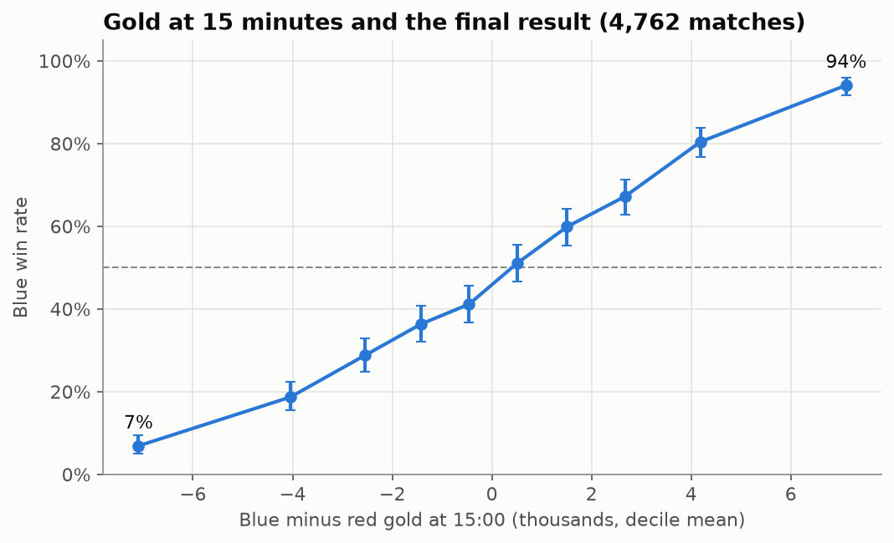
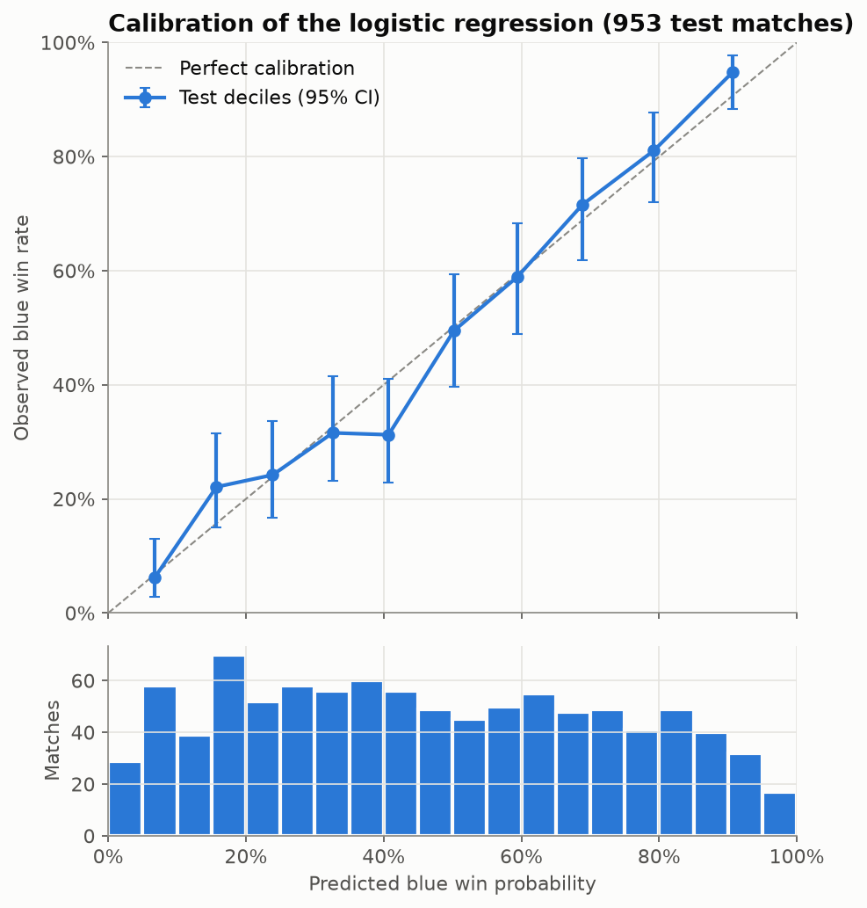
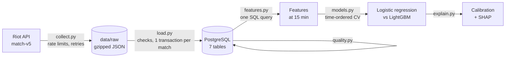
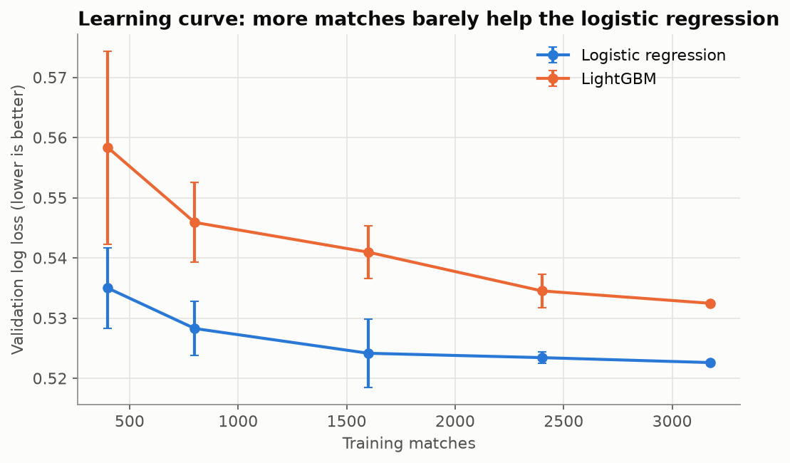
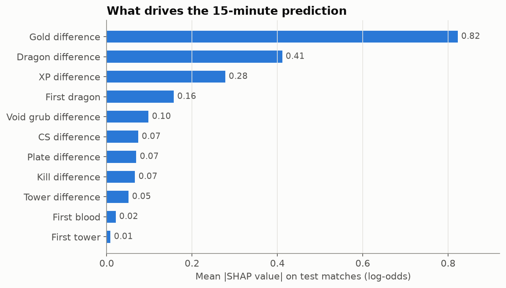

# LoL Analytics

**Can you tell who will win a League of Legends match at 15 minutes, and how much should you trust that guess?**

End-to-end data project on ranked Solo/Duo matches (EUW): collection through the Riot API, a PostgreSQL database, statistical tests, a win-prediction model with leakage-free validation, calibration checks and SHAP explanations.

> **Status: v1.** Data pipeline and 15-minute win model are done. Next: a minute-by-minute win-probability model (GRU, PyTorch), then a Streamlit app.

## Results at a glance

On 4,762 ranked matches (patches 16.14 to 16.21), with the 953 most recent matches held out as a test set and used once:

- **74% accuracy at 15 minutes** (log loss 0.524, AUC 0.81) with a **logistic regression on 11 game-state features**. LightGBM does not beat it (0.528, difference not significant).
- **Gold is most of the story.** The team ahead in gold wins far more often; at equal gold, **dragons** still matter (about as much as 1,000 gold each) and XP adds a little. Kills, towers and CS add nothing beyond the gold they bring.
- **The probabilities can be trusted as they are**: a match announced at 70% is won about 70% of the time (calibration error 2.8 points, all 10 deciles within their confidence interval). No recalibration needed.
- **The limit is the information, not the model.** More matches, more features, tuning and ensembling all failed to improve the test score.
- **Two data leaks were found and measured**, not just avoided (see [Model comparison](#model-comparison-logistic-regression-vs-lightgbm)).

| Gold at 15 minutes vs the final result | Calibration on the test set |
|---|---|
|  |  |

## How it works



Raw API responses are kept on disk before anything is inserted: API calls are the scarce resource (development key: 100 requests per 2 minutes), so the database can be rebuilt at any time without downloading again.

## Project structure

```
lol-analytics/
├── src/
│   ├── riot_api.py       # API client: rate limiter, retries, errors
│   ├── collect.py        # background collection of matches and timelines
│   ├── load.py           # raw JSON -> PostgreSQL (idempotent)
│   ├── quality.py        # consistency checks on the database
│   ├── features.py       # 15-minute features (SQL) and champion scaling score
│   ├── models.py         # models, leakage-free preparation, CV, paired bootstrap
│   ├── explain.py        # calibration tools and SHAP values
│   └── make_figures.py   # rebuilds the README figures
├── notebooks/
│   ├── 01_exploration.ipynb   # exploratory analysis
│   ├── 02_regression.ipynb    # hypothesis tests (statsmodels)
│   ├── 03_models.ipynb        # logistic regression vs LightGBM
│   ├── 04_improvements.ipynb  # learning curve, new features
│   └── 05_calibration.ipynb   # calibration and SHAP
├── sql/schema.sql        # database schema (7 tables)
├── docs/figures/         # README figures
├── data/                 # local data (not versioned)
└── docker-compose.yml    # PostgreSQL 16
```

## Setup

Requirements: Python 3.14 and Docker Desktop.

```bash
# 1. Python environment
python -m venv .venv
.venv\Scripts\activate            # Windows (macOS/Linux: source .venv/bin/activate)
pip install -r requirements.txt

# 2. Configuration
cp .env.example .env               # then add your Riot API key

# 3. Database (PostgreSQL 16 in Docker; tables are created from sql/schema.sql on first start)
docker compose up -d
python src/check_db.py             # should list the 7 tables
```

### Reproducing the results

```bash
python src/collect.py --riot-id "GameName#TAG" --max-matches 5000   # a few hours
python src/load.py                 # insert the new matches
python src/quality.py              # checks, prints OK / ATTENTION
# then run notebooks/01 to 05 in order
python src/make_figures.py         # regenerate docs/figures/
```

Your numbers will differ slightly: the sample depends on the starting player and on the patches you collect.

## Data pipeline

### Collection

`src/collect.py` downloads ranked Solo/Duo matches and their timelines (match-v5) as compressed JSON files in `data/raw/`. It starts from one player and snowballs through the other players of each match.

- **Rate limits**: `src/riot_api.py` keeps the development-key limits (20 requests/s and 100 requests/2 min) with two sliding windows, and waits for `Retry-After` on HTTP 429.
- **Retries**: network errors and 5xx responses are retried with exponential backoff (about 4 minutes in total); after that, or when the 24 h development key expires, the script stops cleanly.
- **Resume**: files are written atomically and never downloaded twice; running the same command again continues after a stop.
- **Long runs**: a timestamped log in `data/logs/collect.log` (with matches per hour and estimated end time), Windows sleep prevention while it runs, and a lock file so two collections never write to the same folder.

```powershell
.\.venv\Scripts\python.exe src\collect.py --riot-id "GameName#TAG" --max-matches 5000
Get-Content data\logs\collect.log -Encoding utf8 -Wait -Tail 20   # follow progress from another window
```

### Loading and quality checks

`src/load.py` reads the raw files and fills the 7 tables of `sql/schema.sql`; `src/quality.py` then runs consistency checks.

- **Idempotent**: matches already in the database are skipped, so the script can run after each collection.
- **One transaction per match**: a match is inserted completely or not at all.
- **Checks before insertion**: remakes, wrong queue, incomplete teams, missing values or a timeline that does not match the game are rejected with a reason.
- **Checks after insertion**: 2 teams and one winner per match, 10 players, no missing minute, total gold never decreasing, and timeline events matching the match summary (kills, towers, dragons).

5,000 matches were collected; 4,907 passed the checks.

## Analysis

### Exploratory analysis

`notebooks/01_exploration.ipynb` reads the database with SQL (aggregations run in PostgreSQL) and plots the main patterns with 95% confidence intervals.

- **Gold at 15 min** is the strongest single signal: the blue side wins 7% of games in the most behind decile and 94% in the most ahead one.
- **Early leads overlap**: gold, XP and kill differences at 15 min are 0.90 to 0.92 correlated, so a model must not read them as independent effects.
- **Red side** wins 51.7% of games (95% CI 50.3% to 53.1%) in this sample.
- **Champions**: among 160 champions played at least 100 times, the number whose win-rate interval excludes 50% is about what chance alone would produce.

### Hypothesis tests

`notebooks/02_regression.ipynb` tests three questions with logistic regression (statsmodels): one row per match seen from the blue side, blue-minus-red differences at 15 min, odds ratios with 95% confidence intervals and likelihood-ratio tests between nested models.

- **Gold almost sums up the lead.** Each 1,000 gold ahead at 15 min multiplies the odds of winning by 1.44. At equal gold, **dragons still matter** (odds ratio 1.30 per dragon ahead, about the weight of 1,000 gold) and XP adds a little (1.10 per 1,000 XP); kills, towers, plates and CS add nothing beyond their gold.
- **First tower has no effect of its own.** It goes with 2.5 times higher odds, but at equal gold the effect disappears (0.94, 95% CI 0.79 to 1.13): it is a sign of the lead, not an extra cause.
- **The red-side edge is small and goes through dragons.** Blue wins 48.5% of games (95% CI 47.0% to 49.9%); at equal dragon difference the edge is gone (50.9%, 95% CI 49.1% to 52.7%).

These are controlled associations, not causal effects: player skill and team compositions are not measured.

## Predicting the winner at 15 minutes

### Features

`src/features.py` builds one row per match seen from the blue side, with blue-minus-red differences at 15 min, in a single SQL query.

- **Game state** (11 features): gold, XP, CS, kills, towers, plates, dragons and void grubs taken before 15 min, plus first blood / first tower / first dragon coded +1 (blue), −1 (red), 0 (none).
- **Gold by role**: the gold difference per position, for tree models only (it adds up to total gold, so it would be collinear in a logistic regression).
- **No leakage by design**: only events before 15 min; columns known only after the game (duration) are kept apart from the feature lists.
- **Champion scaling score**: each champion's win rate in long games minus its win rate in short games, smoothed towards 50% so that rare champions do not get extreme scores by chance. It uses the match outcome, so it is **learned on training matches only** and then applied to test matches. Sanity check: the top scores go to known late-game champions (Kayle, Kassadin, Vladimir) and the lowest to early-game ones (Kled, Kennen, Mordekaiser).

### Model comparison: logistic regression vs LightGBM

`notebooks/03_models.ipynb`, with reusable pieces in `src/models.py`.

- **Protocol**: the 953 most recent matches are the test set, used once. Every choice (LightGBM hyperparameters, feature sets) is made on the 3,809 older matches with **time-ordered cross-validation** (5 folds, always validating on matches more recent than the training ones). Main metric: **log loss**, which rates the probabilities and not only the predicted winner.
- **No leakage**: the scaling scores, the scaler and the model are refit inside each fold, and training matches get **out-of-fold** scaling scores, so that no match sees its own result in its score (the classic target-encoding trap).

Test-set results (953 matches):

| Model | Features | Log loss | AUC | Accuracy |
|---|---|---|---|---|
| Constant (blue win rate) | none | 0.692 | 0.500 | 52.9% |
| Logistic regression | gold only | 0.539 | 0.799 | 72.5% |
| **Logistic regression** | **11 game-state features** | **0.524** | **0.813** | **74.1%** |
| Logistic regression | + scaling score and gold × scaling | 0.527 | 0.812 | 74.4% |
| LightGBM (4 leaves, 200 trees) | 11 features + gold by role | 0.528 | 0.809 | 73.0% |
| LightGBM | + scaling score | 0.530 | 0.808 | 73.4% |

- **Logistic regression is the chosen model.** LightGBM is not significantly different (paired bootstrap on log loss: +0.004, 95% CI −0.003 to +0.011) and is behind on 3 of 5 folds; the best LightGBM is the simplest in the grid. The signal is mostly linear and driven by gold.
- **The 11 features beat gold alone** (−0.015 log loss, 95% CI −0.026 to −0.005).
- **The scaling score does not help at 15 minutes** (+0.002, CI −0.003 to +0.008).
- **Leakage, measured**: learning the scaling scores with the validation matches makes the score look useful (0.524 instead of 0.530 in cross-validation); applying them to the matches they were learned on makes the model overweight it and do worse (0.535). Leakage can bias a conclusion in either direction.

### Trying to improve the model

`notebooks/04_improvements.ipynb` tests whether more data or more features would help (same protocol, test set used once).



- **Learning curve**: going from 1,600 to 3,175 training matches moves the logistic regression's validation log loss from 0.524 to 0.523. LightGBM is still improving but starts about 0.01 behind. Collecting many more matches would not change the picture.
- **New features** (gold at 10 min and gold trend, level difference, richest-player gap, players dead at 15:00, dragons by type) are 0.80 to 0.89 correlated with gold. Two groups passed a selection rule fixed in advance, but the gain vanished on the test set (+0.003, 95% CI −0.002 to +0.007): a small cross-validation gain after trying five groups is mostly luck.
- **Regularization and ensembling** do not help either.

### Calibration and explanations

`notebooks/05_calibration.ipynb`, with tools in `src/explain.py`.

- **Well calibrated as is.** On the test set: Brier score 0.175, expected calibration error 2.8 points, calibration slope 1.04 (95% CI 0.89 to 1.18), and all 10 probability deciles within the confidence interval of the predicted rate. The model also commits: 35% of matches get a probability below 20% or above 80%. LightGBM is slightly worse (error 4.2 points).
- **No recalibration kept.** Platt scaling and isotonic regression, learned on out-of-fold predictions, make the test log loss slightly worse (+0.001 and +0.007). Those out-of-fold predictions come from models trained on fewer matches and are overconfident (slope 0.93), a flaw the final model does not have: recalibrating on them would fix a problem that is not there.
- **SHAP without the `shap` package.** For a linear model the exact SHAP value of a feature is coefficient × (value − training mean), on the log-odds scale; LightGBM computes TreeSHAP itself (`pred_contrib=True`). Both match the `shap` library to 1e-15.



Gold difference dominates (0.82), then dragons (0.41) and XP (0.28). Kills, towers and CS get small negative weights at equal gold: SHAP explains the model, not causes in the game, and gold and XP should be read together since they move together.

## Limitations

- **Sample**: about 5,000 EUW Solo/Duo matches from a snowball that starts at one player, over eight patches. It is not a random sample of the ladder, and rank is not used.
- **One moment in the game**: the model only looks at the state at 15:00. The minute-by-minute model is the next step.
- **Associations, not causes**: team compositions, player skill and in-game decisions are not measured.

## Roadmap

- **Deep learning**: minute-by-minute win probability with a GRU (PyTorch), compared with LightGBM.
- **App**: Streamlit dashboard (Riot ID → matches, win-probability curve, key moments), Docker Compose, pytest and GitHub Actions.

## Data & privacy

Match data comes from the [Riot Games API](https://developer.riotgames.com/). Raw data and API keys are not published in this repository; player identifiers are pseudonymized.

*LoL Analytics isn't endorsed by Riot Games and doesn't reflect the views or opinions of Riot Games or anyone officially involved in producing or managing Riot Games properties. Riot Games, and all associated properties are trademarks or registered trademarks of Riot Games, Inc.*
